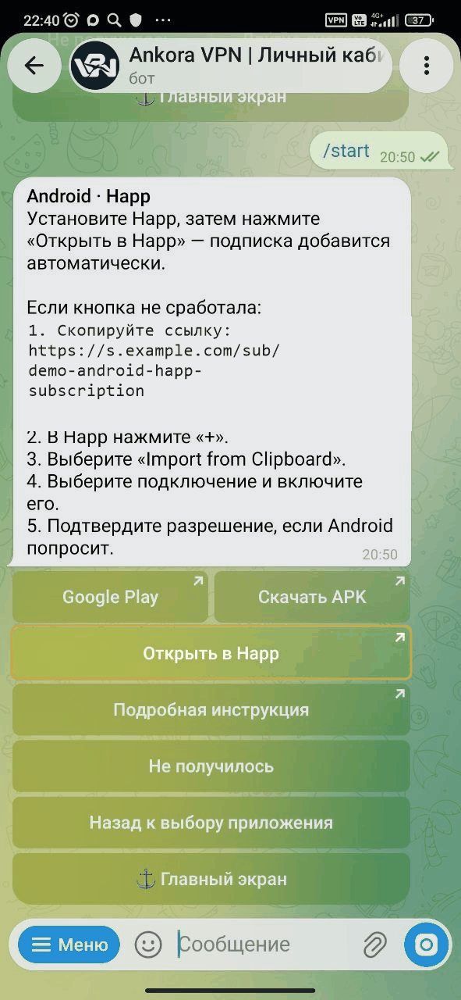
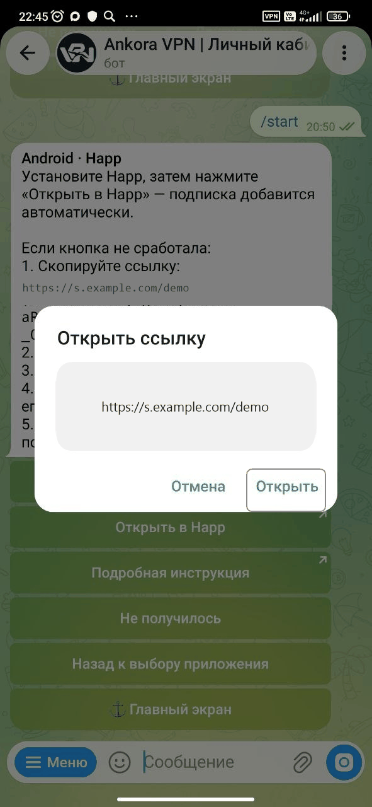
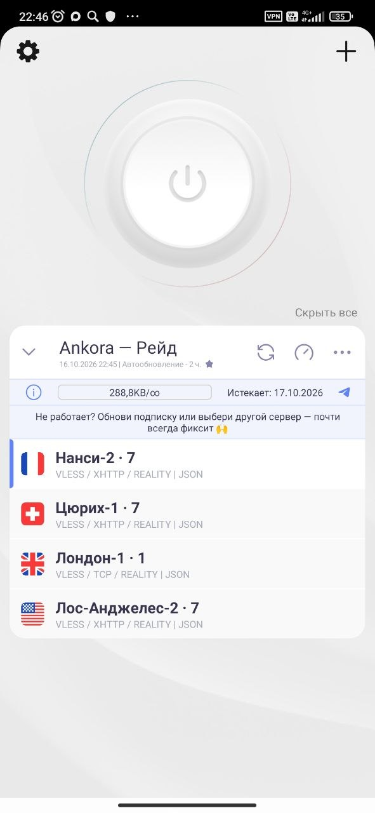
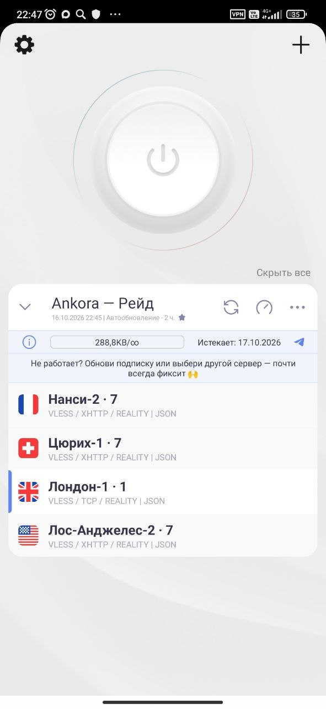
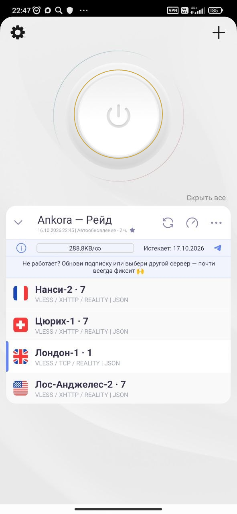
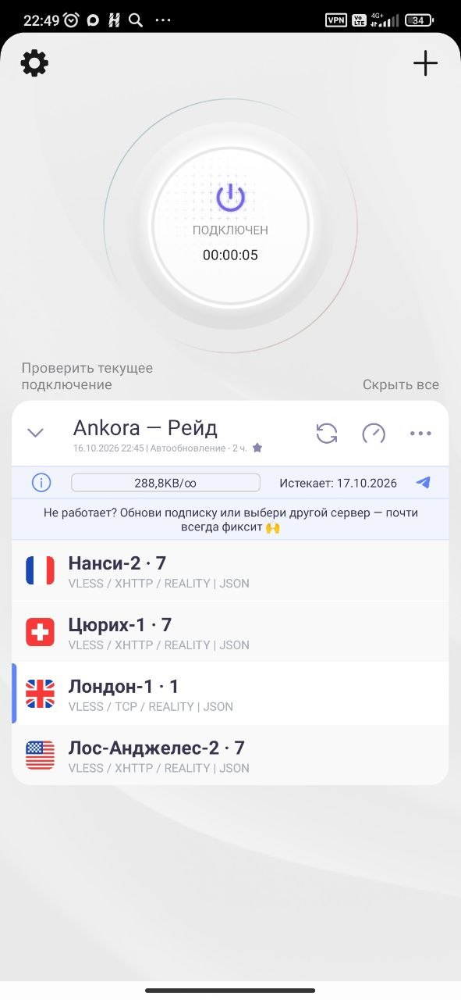
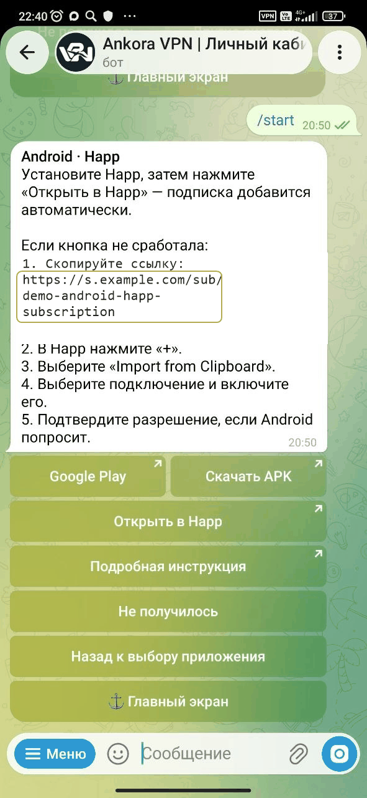
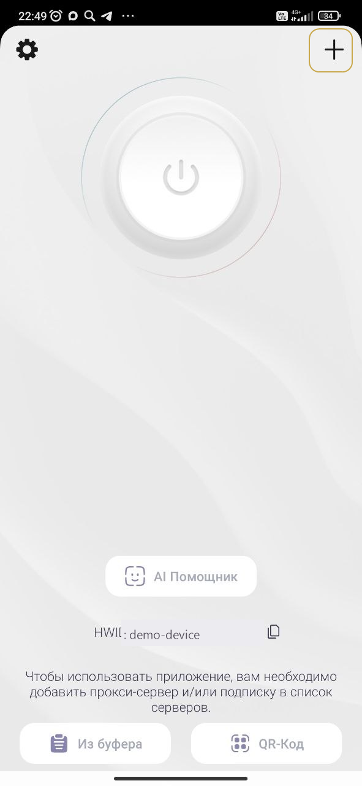
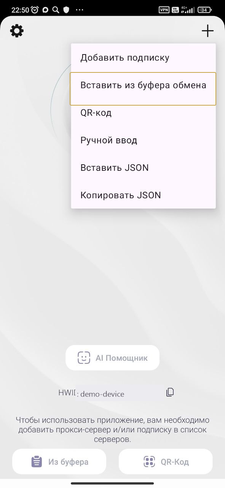

# Как добавить подписку в Happ на Android

Happ на Android умеет принимать подписку непосредственно из бота Ankora. Ниже также показан ручной импорт на случай, если автоматический переход не сработал.

[Получить подписку в Ankora](https://t.me/AnkoraNetBot?start=github)

## Видео: добавление из бота

*Видео: автоматическое добавление подписки Ankora в Happ на Android.*

[Смотреть видео](https://getankora.app/help/android/video/)

## Автоматический способ

1. **Установите Happ.** Откройте страницу приложения по ссылке из Ankora и завершите установку.

   

   *Установка Happ на Android перед добавлением подписки Ankora.*

2. **Запустите передачу подписки.** На экране подключения в боте нажмите кнопку открытия в Happ.

   

   *Открытие подписки Ankora в Happ на Android из Telegram-бота.*

3. **Выберите Happ в системном окне.** Android может попросить подтвердить, каким приложением открыть ссылку.

   

   *Выбор Happ для открытия ссылки подписки на Android.*

4. **Убедитесь, что подписка появилась.** После загрузки Happ покажет добавленную запись и список подключений.

   

   *Добавленная подписка Ankora в приложении Happ на Android.*

5. **Нажмите на нужную строку.** Так выбирается вариант подключения.

   

   *Выбор подключения из списка Happ на Android.*

6. **Включите соединение.** Используйте большую круглую кнопку на главном экране.

   

   *Кнопка запуска подключения в Happ на Android.*

7. **Разрешите первое подключение.** Подтвердите системный запрос Android.

   

   *Системный запрос Android при первом подключении через Happ.*

8. **Посмотрите на статус.** Таймер и активное состояние подтверждают, что Happ работает.

   

   *Включённое подключение Ankora в Happ на Android.*

## Видео: добавление по ссылке

*Видео: ручной импорт подписки Ankora в Happ на Android.*

[Смотреть видео](https://getankora.app/help/android/video/manual/)

## Ручной способ

1. **Сохраните ссылку в буфер обмена.** Нажмите на ссылку подписки в боте Ankora.

   

   *Копирование ссылки подписки Ankora для Happ на Android.*

2. **Откройте меню добавления.** В Happ нажмите знак «+».

   

   *Кнопка добавления новой подписки в Happ на Android.*

3. **Вставьте скопированную ссылку.** Выберите импорт из буфера обмена и дождитесь появления списка.

   

   *Вставка ссылки подписки из буфера обмена в Happ на Android.*

4. **Выберите вариант и запустите его.** Дальнейшие действия совпадают с шагами 5–8 автоматического способа.

Полная пошаговая версия доступна в [инструкции Ankora для Android](https://getankora.app/help/android/details/).

[Открыть Ankora или обратиться в поддержку](https://t.me/AnkoraNetBot?start=github)

## Другие инструкции

- [Happ на iPhone](happ-iphone.md)
- [Happ на Windows](happ-windows.md)
- [Happ на macOS](happ-macos.md)
- [INCY на iPhone](incy-iphone.md)
- [INCY на Android](incy-android.md)
- [v2rayN на Windows](windows-v2rayn.md)
- [Если подключение не включается](trouble.md)
