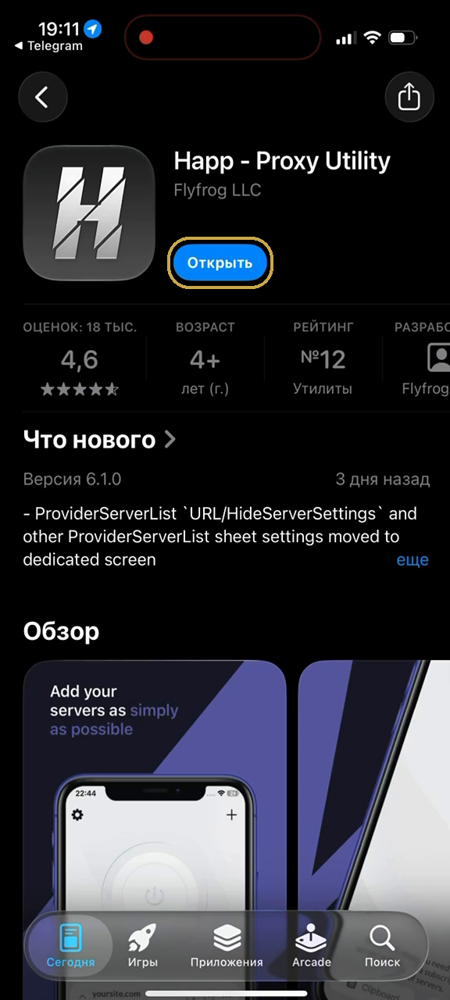
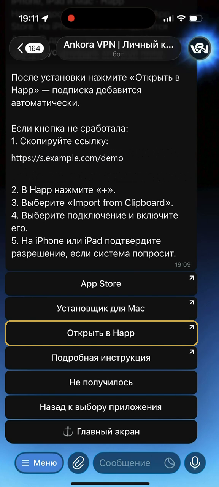
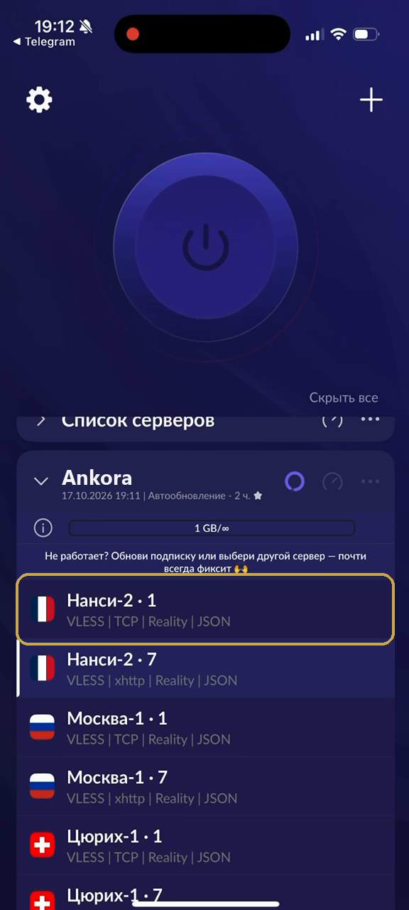
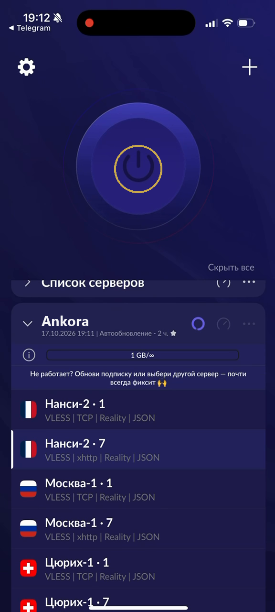
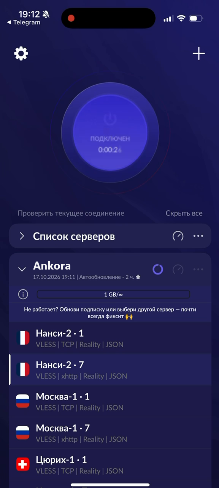
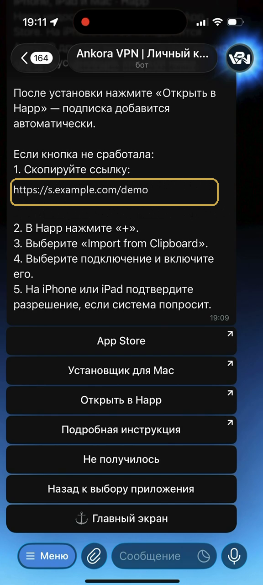
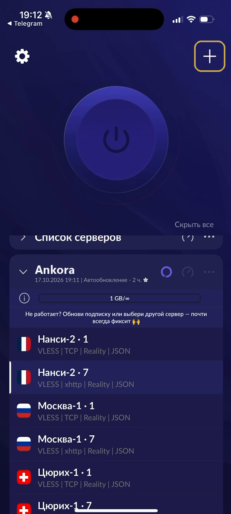
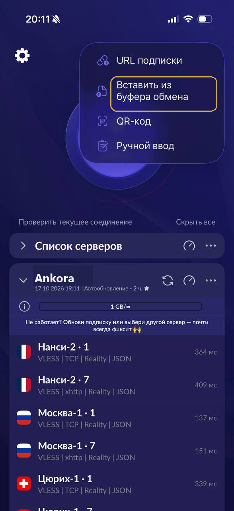

# Как добавить подписку в Happ на iPhone

Самый короткий путь — передать подписку из Ankora прямо в Happ. Если iPhone не открыл приложение автоматически, ту же настройку можно добавить через буфер обмена.

[Открыть Ankora и получить подписку](https://t.me/AnkoraNetBot?start=github)

## Посмотреть автоматический способ

*Видео: добавление подписки Ankora в Happ на iPhone.*

[Смотреть видео](https://getankora.app/help/iphone/video/)

## Открытие подписки из бота

1. **Установите Happ.** Перейдите в App Store по ссылке из инструкции Ankora и дождитесь окончания установки.

   

   *Установка Happ на iPhone из App Store перед подключением подписки.*

2. **Вернитесь к экрану подключения Ankora.** Нажмите кнопку, которая передаёт подписку в Happ.

   

   *Передача подписки Ankora из Telegram-бота в Happ на iPhone.*

3. **Разрешите открыть приложение.** Подтвердите переход, если iPhone покажет системное окно.

4. **Подождите несколько секунд.** Happ примет подписку и сформирует список вариантов подключения.

5. **Отметьте подходящий вариант.** Нажмите на одну из строк в списке.

   

   *Выбор подключения из подписки Ankora в Happ на iPhone.*

6. **Нажмите кнопку запуска.** Большая кнопка находится в верхней части экрана Happ.

   

   *Запуск выбранного подключения в приложении Happ на iPhone.*

7. **Подтвердите запрос iOS.** При первом использовании система попросит разрешение на добавление конфигурации.

8. **Проверьте состояние.** Активный статус и таймер означают, что подключение включено.

   

   *Активное подключение Ankora в Happ на iPhone с таймером.*

## Добавление через скопированную ссылку

1. **Скопируйте ссылку подписки.** Нажмите на неё в боте Ankora и сохраните в буфер обмена.

   

   *Копирование ссылки подписки Ankora для Happ на iPhone.*

2. **Откройте добавление в Happ.** Нажмите знак «+» в правом верхнем углу.

   

   *Добавление новой подписки через кнопку плюс в Happ на iPhone.*

3. **Импортируйте данные.** Выберите вставку из буфера обмена и разрешите доступ, если iPhone его запросит.

   

   *Импорт ссылки подписки из буфера обмена в Happ на iPhone.*

4. **Завершите подключение.** Выберите вариант из появившегося списка и включите его, как описано выше.

Расширенная версия с обоими способами находится на [сайте Ankora](https://getankora.app/help/iphone/details/).

[Вернуться в Ankora или написать поддержке](https://t.me/AnkoraNetBot?start=github)

## Другие инструкции

- [Happ на Android](happ-android.md)
- [Happ на Windows](happ-windows.md)
- [Happ на macOS](happ-macos.md)
- [INCY на iPhone](incy-iphone.md)
- [INCY на Android](incy-android.md)
- [v2rayN на Windows](windows-v2rayn.md)
- [Если подключение не включается](trouble.md)
