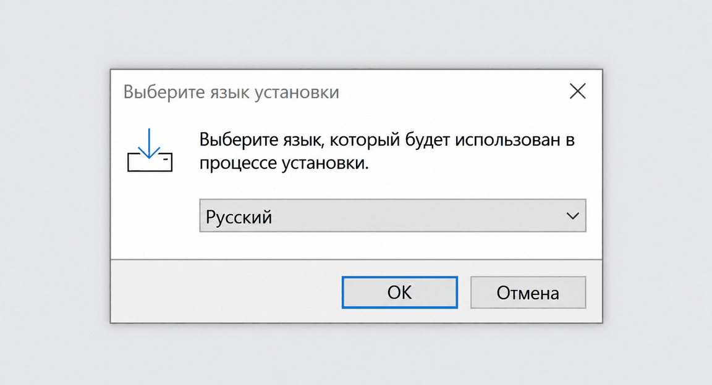
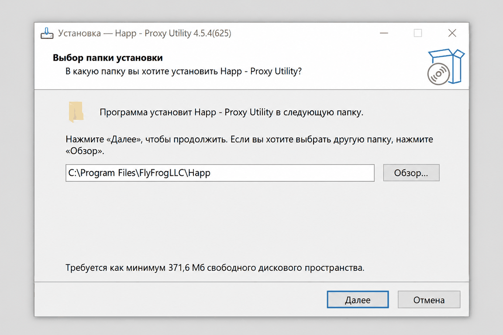
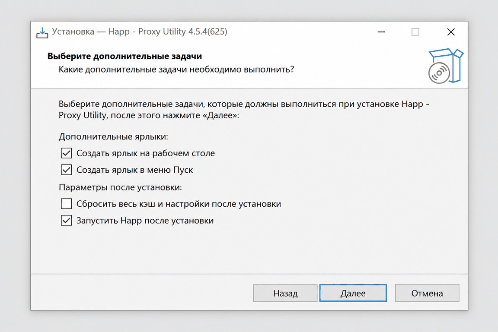
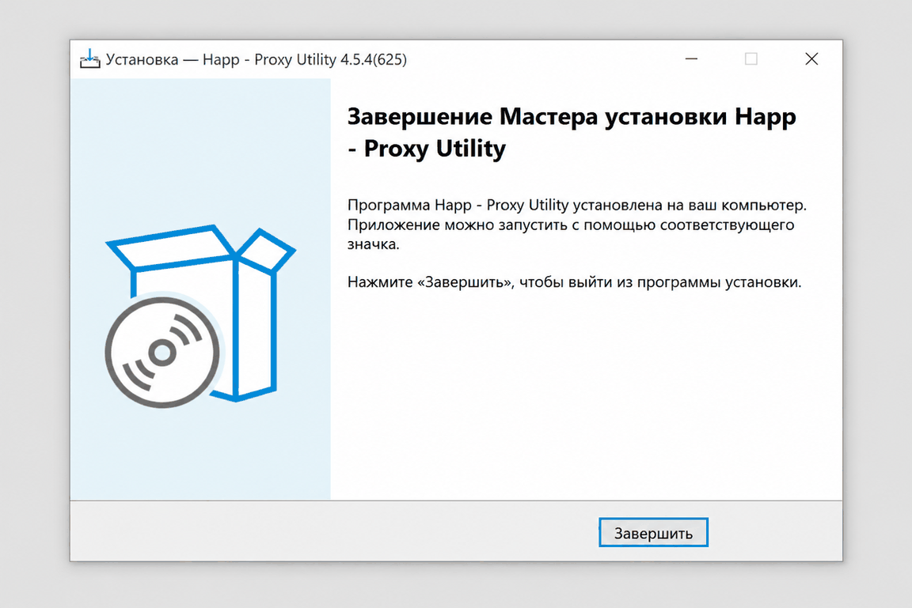
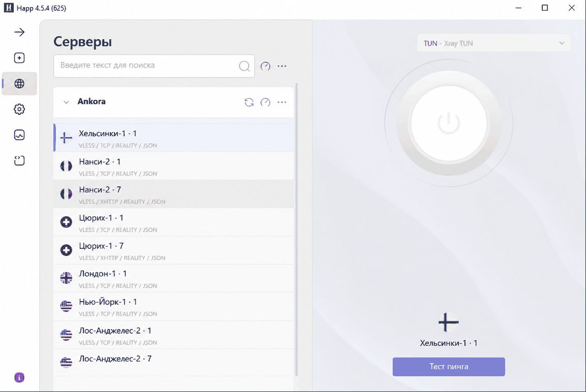
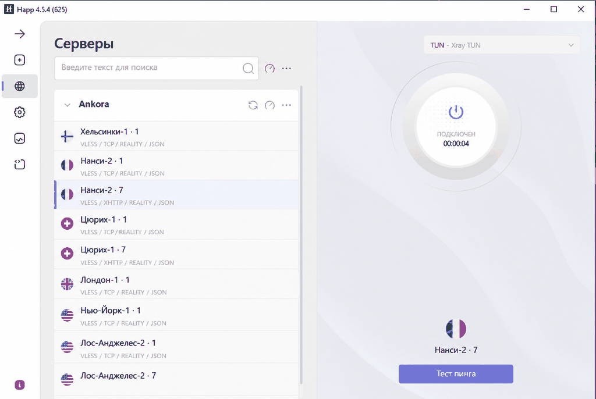

# Как добавить подписку в Happ на Windows

На Windows подписка добавляется в Happ вручную по ссылке. Бот можно открыть на телефоне или компьютере — важно только безопасно перенести ссылку на устройство, где установлен Happ.

[Получить ссылку подписки в Ankora](https://t.me/AnkoraNetBot?start=github)

## Установка и подключение

1. **Скачайте установщик для своей системы.** Для большинства компьютеров подходит [версия x64](https://github.com/Happ-proxy/happ-desktop/releases/latest/download/setup-Happ.x64.exe). Для устройств на ARM используйте [версию ARM64](https://github.com/Happ-proxy/happ-desktop/releases/latest/download/setup-Happ.arm64.exe).

2. **Откройте файл и выберите русский язык.** После выбора продолжите установку.

   

   *Выбор русского языка при установке Happ на Windows.*

3. **Оставьте стандартную папку.** Менять путь установки обычно не требуется.

   

   *Стандартная папка установки приложения Happ на Windows.*

4. **Проверьте дополнительные параметры.** Подходят значения, предложенные установщиком.

   

   *Дополнительные параметры установки Happ на Windows.*

5. **Завершите установку.** Оставьте запуск Happ включённым и закройте установщик.

   

   *Завершение установки и запуск Happ на Windows.*

6. **Скопируйте ссылку Ankora.** Получите её в боте на любом устройстве. Для передачи на компьютер подойдут «Избранное» Telegram, личное письмо, личный чат или синхронизируемая заметка. Не размещайте ссылку в общих чатах.

   

   *Безопасный пример ссылки подписки Ankora для Happ на Windows.*

7. **Вставьте ссылку в Happ.** Откройте приложение, поместите ссылку в поле добавления и нажмите «Поехали».

   

   *Вставка ссылки подписки Ankora в приложение Happ на Windows.*

8. **Выберите локацию.** Дождитесь появления списка и нажмите на подходящий вариант.

   

   *Выбор локации из подписки Ankora в Happ на Windows.*

9. **Включите подключение.** Нажмите большую круглую кнопку. Статус и таймер под ней подтвердят результат.

   

   *Успешное подключение Ankora в Happ на Windows.*

Версия с дополнительными пояснениями доступна в [подробной инструкции Ankora для Windows](https://getankora.app/help/windows/details/).

[Вернуться в Ankora или написать поддержке](https://t.me/AnkoraNetBot?start=github)

## Другие инструкции

- [Happ на iPhone](happ-iphone.md)
- [Happ на Android](happ-android.md)
- [Happ на macOS](happ-macos.md)
- [INCY на iPhone](incy-iphone.md)
- [INCY на Android](incy-android.md)
- [v2rayN на Windows](windows-v2rayn.md)
- [Если подключение не включается](trouble.md)
