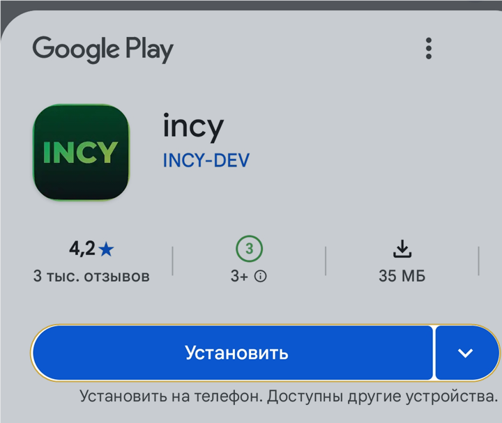
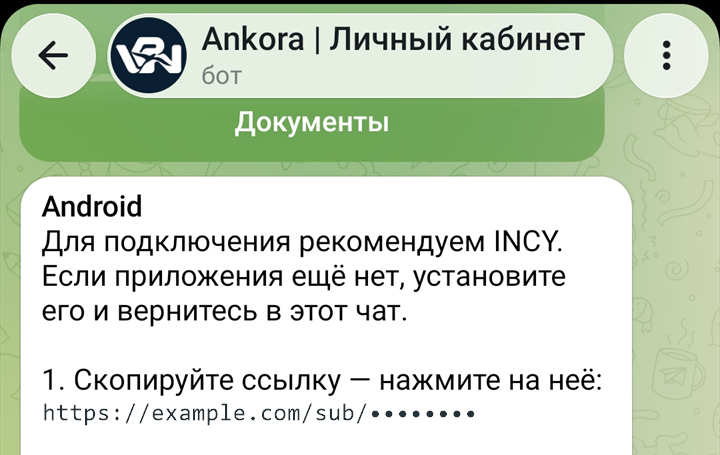
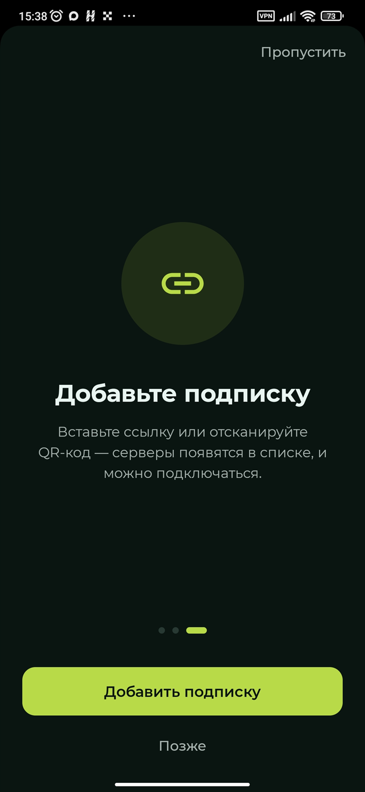
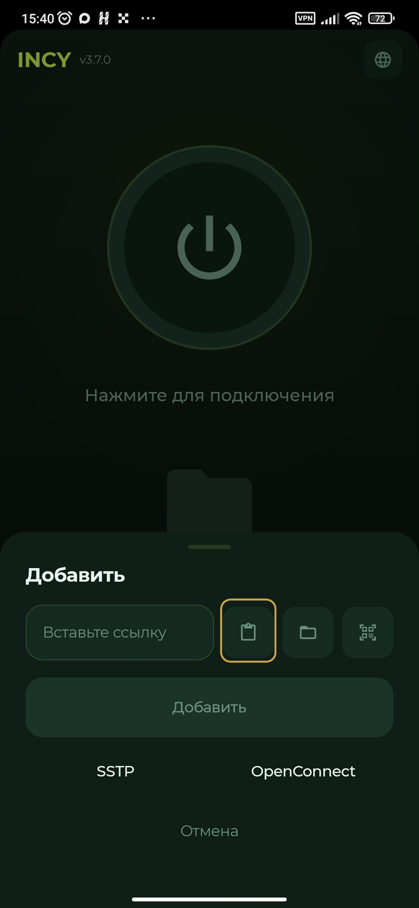
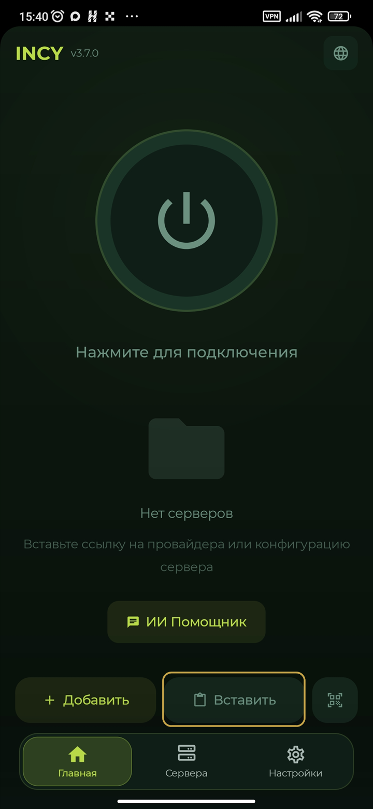
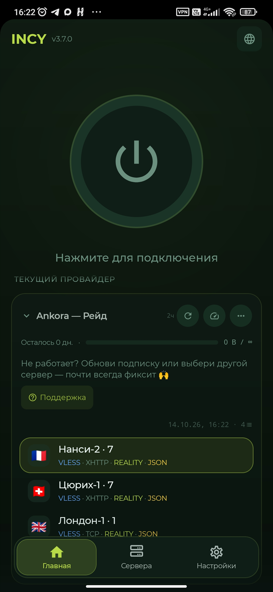
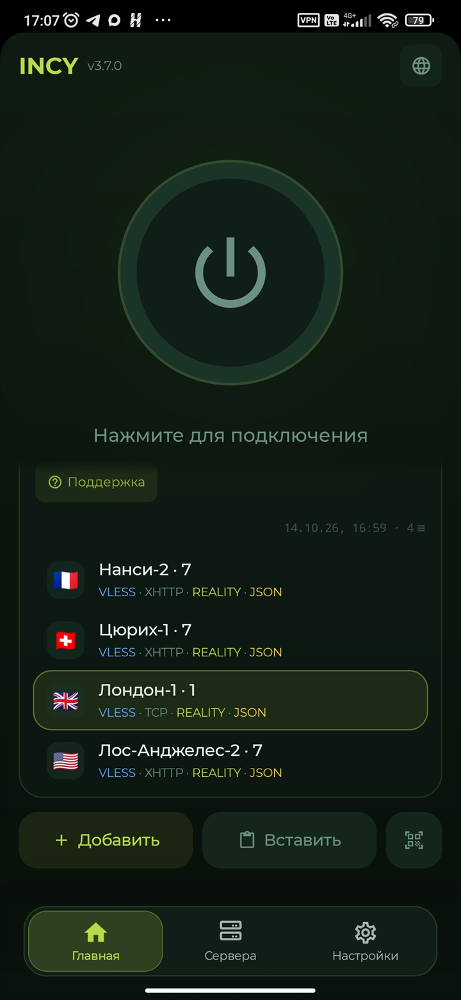
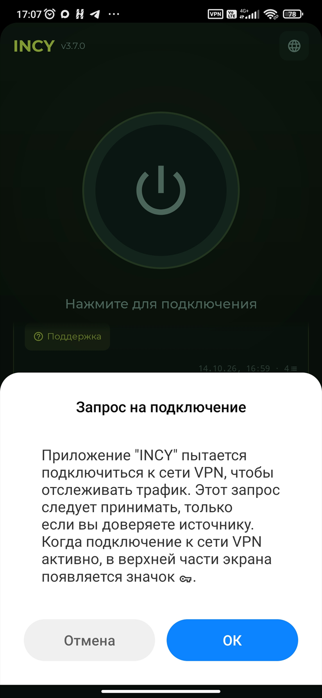
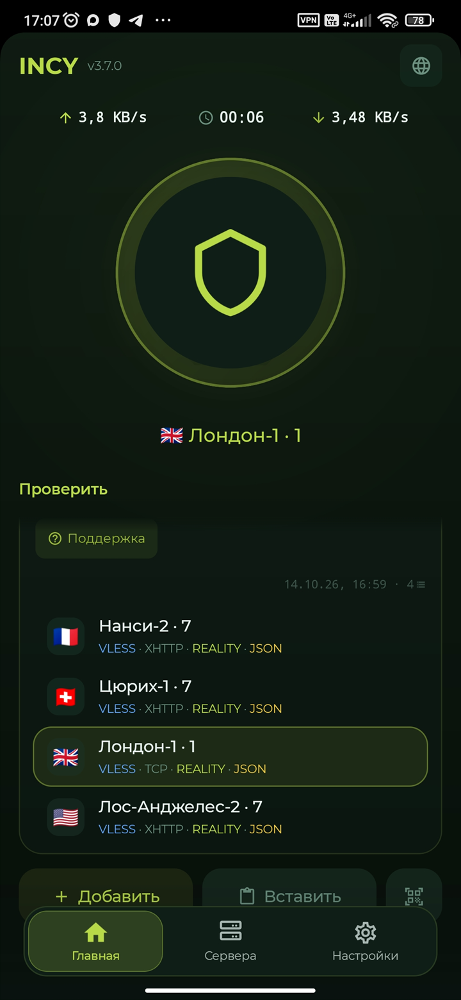

# Как добавить подписку в INCY на Android

Для INCY на Android понадобится ссылка подписки Ankora. Способ её вставки немного отличается при первом запуске приложения и при повторном открытии.

[Получить ссылку подписки в Ankora](https://t.me/AnkoraNetBot?start=github)

## Видеоинструкция

*Видео: добавление подписки Ankora в INCY на Android.*

[Смотреть видео](https://getankora.app/help/android/incy/video/)

## Пошаговое подключение

1. **Установите INCY.** Откройте Google Play по ссылке из Ankora, нажмите кнопку установки и дождитесь завершения.

   

   *Установка приложения INCY на Android из Google Play.*

2. **Скопируйте ссылку подписки.** Вернитесь на экран подключения Ankora и нажмите на ссылку.

   

   *Копирование ссылки подписки Ankora для INCY на Android.*

3. **Определите, какой экран открылся.** При первом запуске INCY показывает мастер настройки.

   

   *Мастер первого запуска приложения INCY на Android.*

4. **В мастере нажмите добавление подписки.** Перейдите к нужному экрану и вставьте данные из буфера обмена.

   

   *Добавление ссылки подписки в мастере INCY на Android.*

5. **При повторном запуске используйте главный экран.** Нажмите кнопку вставки в нижней части INCY.

   

   *Вставка ссылки подписки на главном экране INCY на Android.*

6. **Дождитесь загрузки данных.** После импорта приложение покажет список доступных подключений.

   

   *Список подключений подписки Ankora в INCY на Android.*

7. **Выберите строку и запустите её.** Используйте основную кнопку приложения.

   

   *Запуск выбранного подключения в INCY на Android.*

8. **Подтвердите запрос Android.** При первом подключении системе потребуется ваше разрешение.

   

   *Системное разрешение Android для подключения через INCY.*

9. **Убедитесь, что соединение активно.** INCY покажет таймер и текущую передачу данных.

   

   *Активное подключение Ankora в INCY на Android.*

Подробная версия находится на [сайте Ankora](https://getankora.app/help/android/incy/details/).

[Открыть Ankora или обратиться в поддержку](https://t.me/AnkoraNetBot?start=github)

## Другие инструкции

- [Happ на iPhone](happ-iphone.md)
- [Happ на Android](happ-android.md)
- [Happ на Windows](happ-windows.md)
- [Happ на macOS](happ-macos.md)
- [INCY на iPhone](incy-iphone.md)
- [v2rayN на Windows](windows-v2rayn.md)
- [Если подключение не включается](trouble.md)
