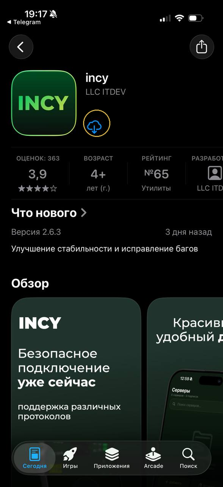
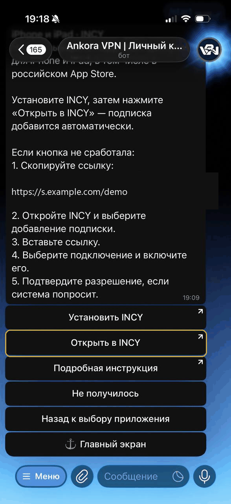
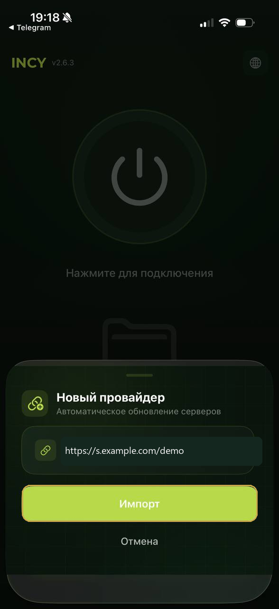
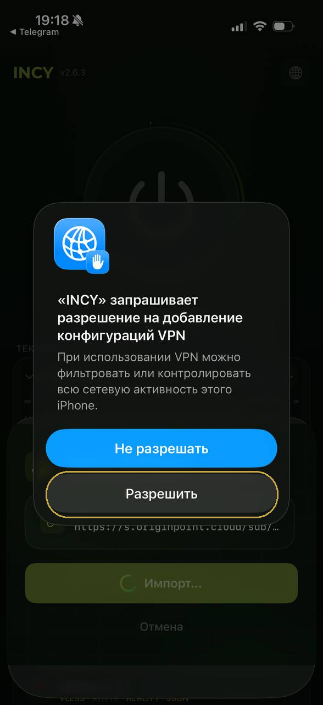
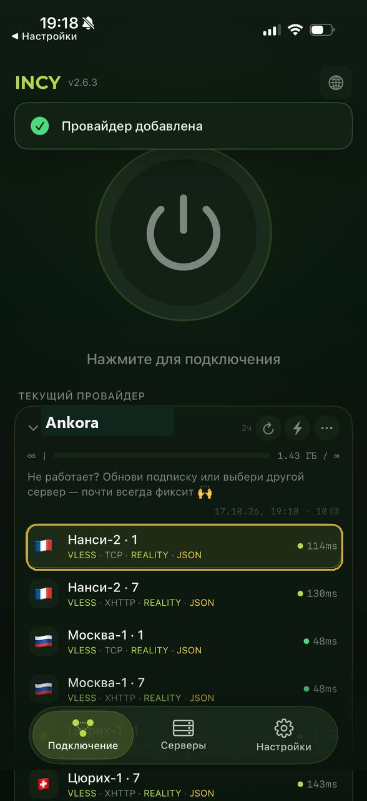
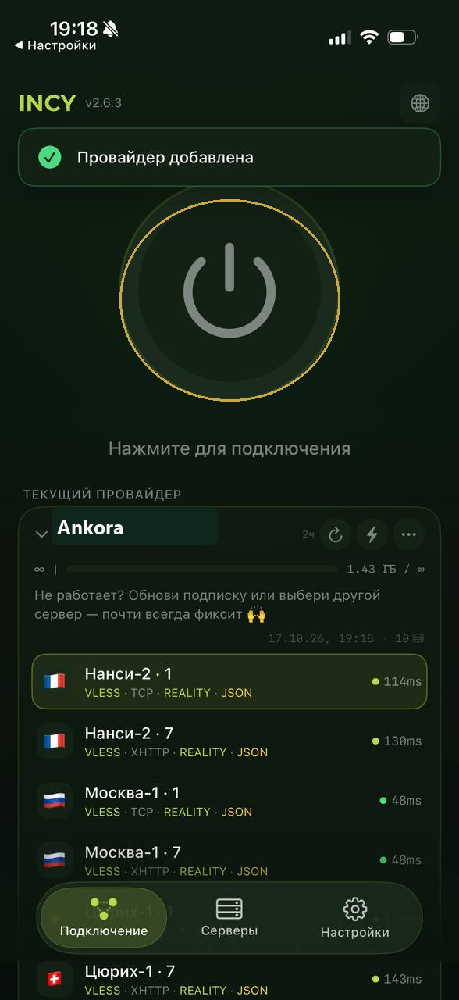
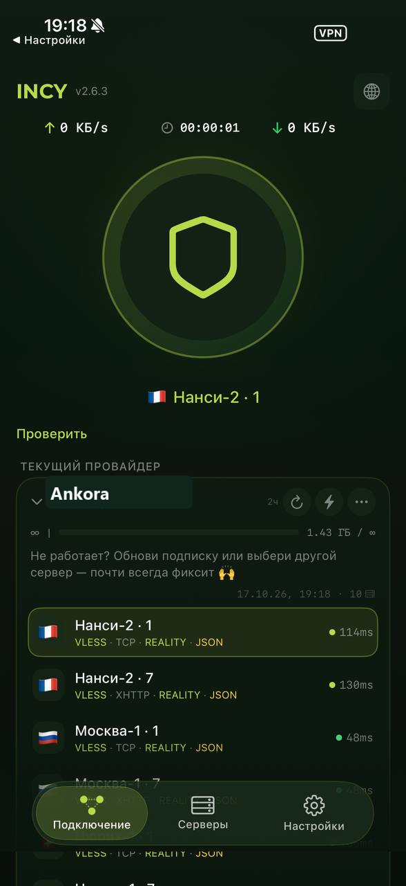

# Как добавить подписку в INCY на iPhone

INCY получает подписку Ankora через кнопку в боте и показывает готовый список подключений. Если переход между приложениями не сработает, ссылку можно скопировать вручную.

[Открыть Ankora и получить подписку](https://t.me/AnkoraNetBot?start=github)

## Добавление подписки из бота

1. **Установите INCY.** Откройте App Store по ссылке из инструкции Ankora и загрузите приложение.

   

   *Установка INCY на iPhone из App Store.*

2. **Снова откройте бот Ankora.** Выберите iPhone, а затем приложение INCY.

3. **Передайте подписку в приложение.** Нажмите кнопку открытия в INCY.

   

   *Передача подписки Ankora из Telegram-бота в INCY на iPhone.*

4. **Подтвердите импорт.** INCY откроет форму с уже добавленными данными; нажмите кнопку импорта.

   

   *Импорт подписки Ankora в приложении INCY на iPhone.*

5. **Разрешите системную настройку.** Подтвердите запрос iPhone при первом подключении.

   

   *Разрешение системной настройки для INCY на iPhone.*

6. **Выберите один вариант.** Нажмите на подходящую строку в списке INCY.

   

   *Выбор подключения из подписки Ankora в INCY на iPhone.*

7. **Запустите подключение.** Используйте центральную кнопку в верхней части приложения.

   

   *Запуск выбранного подключения в INCY на iPhone.*

8. **Проверьте результат.** На экране появятся активное состояние и время работы.

   

   *Активное подключение Ankora в INCY на iPhone.*

## Если кнопка открытия не помогла

1. **Скопируйте ссылку подписки в Ankora.** Она сохранится в буфере обмена iPhone.

   

   *Копирование ссылки подписки Ankora для INCY на iPhone.*

2. **Создайте новую подписку в INCY.** Вставьте ссылку в форму импорта и подтвердите добавление.

3. **Продолжите с выбора подключения.** Используйте шаги 5–8 основной инструкции.

Оба способа подробнее разобраны на [странице Ankora для INCY на iPhone](https://getankora.app/help/iphone/incy/details/).

[Вернуться в Ankora или написать поддержке](https://t.me/AnkoraNetBot?start=github)

## Другие инструкции

- [Happ на iPhone](happ-iphone.md)
- [Happ на Android](happ-android.md)
- [Happ на Windows](happ-windows.md)
- [Happ на macOS](happ-macos.md)
- [INCY на Android](incy-android.md)
- [v2rayN на Windows](windows-v2rayn.md)
- [Если подключение не включается](trouble.md)
